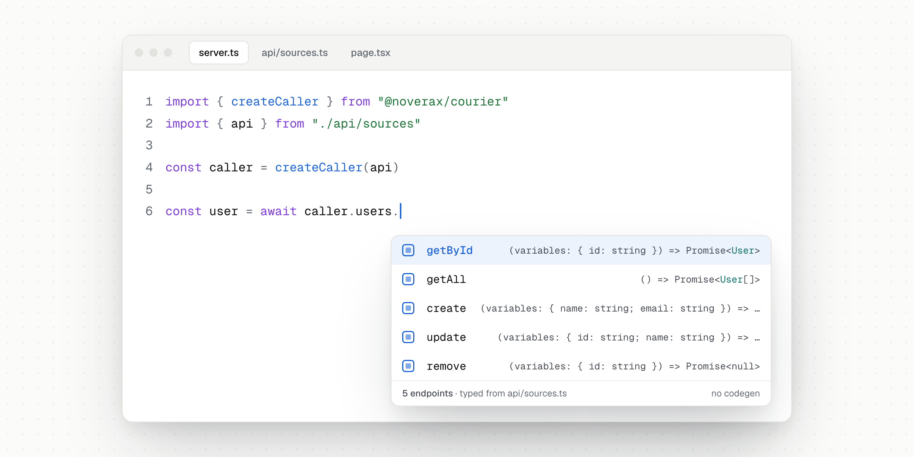
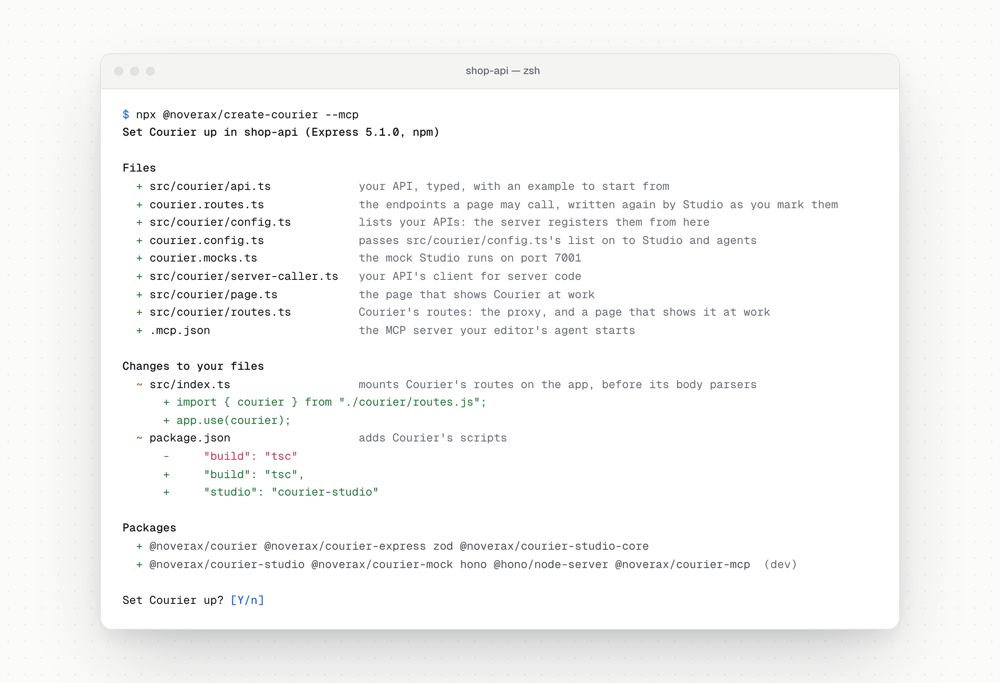
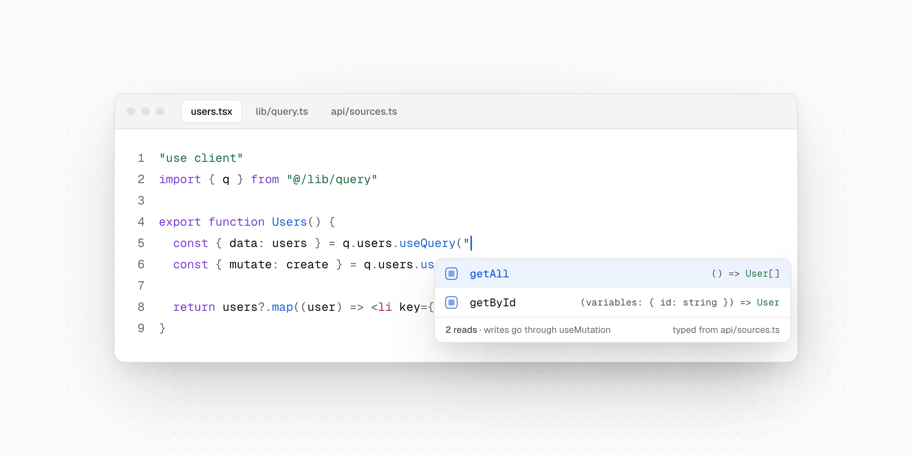
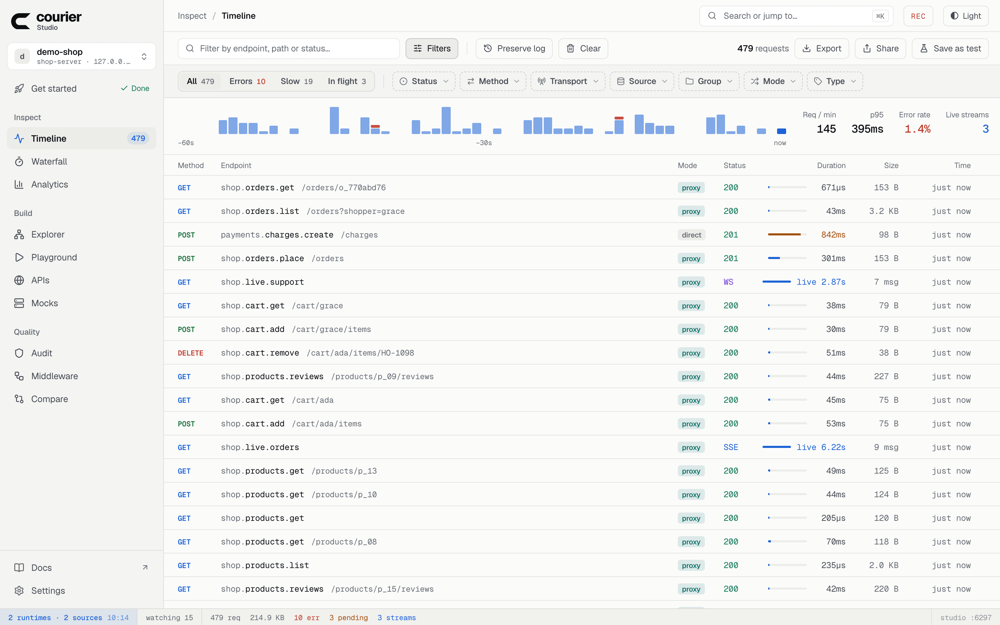
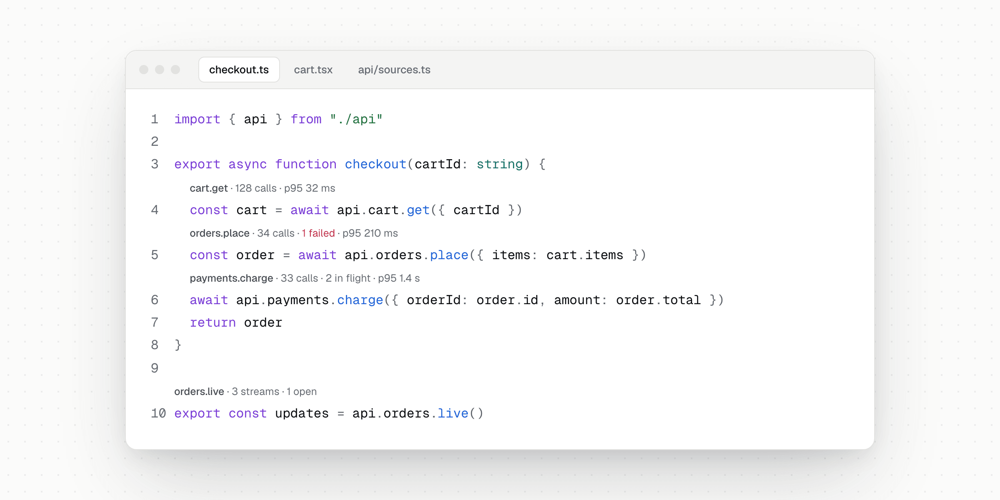
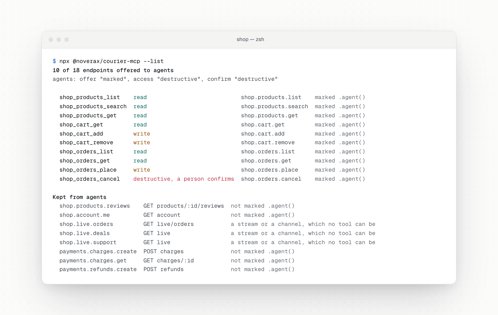

<div align="center">
  <br />
  <picture>
    <source media="(prefers-color-scheme: dark)" srcset="docs/public/logos/courier-mark-light.svg" />
    <source media="(prefers-color-scheme: light)" srcset="docs/public/logos/courier-mark-dark.svg" />
    
  </picture>

  <h1>Courier</h1>

  <p><strong>Type-safe HTTP for any framework.</strong></p>

  <p>
    Define your API once in plain TypeScript. Call it from server code, from the browser through a proxy<br />
    that keeps your keys and sessions on the server, over SSE and WebSockets — and hand it to AI agents as tools.<br />
    Every call, live, in Studio.
  </p>

  <p><sub>No codegen&nbsp;&nbsp;·&nbsp;&nbsp;No schema files&nbsp;&nbsp;·&nbsp;&nbsp;Any backend that speaks HTTP</sub></p>

  <p>
    <a href="https://www.npmjs.com/package/@noverax/courier"></a>
    <a href="https://github.com/NoveraX/courier/actions/workflows/ci.yml"></a>
    <a href="https://www.typescriptlang.org/"></a>
    <a href="./LICENSE"></a>
  </p>

  <p>
    <a href="https://courier.noverax.cloud"><strong>Documentation</strong></a>
    &nbsp;·&nbsp;
    <a href="#quick-start">Quick start</a>
    &nbsp;·&nbsp;
    <a href="#courier-studio">Studio</a>
    &nbsp;·&nbsp;
    <a href="#your-api-as-tools-for-ai-agents">AI agents</a>
    &nbsp;·&nbsp;
    <a href="#packages">Packages</a>
  </p>

  <br />

  <picture>
    <source media="(prefers-color-scheme: dark)" srcset=".github/assets/hero-dark.png" />
    <source media="(prefers-color-scheme: light)" srcset=".github/assets/hero-light.png" />
    
  </picture>
</div>

<br />

## Why Courier

Most HTTP clients stop at “send a request, get a response”. The types live in one place, the validation in another, the retries in a third — and the browser either talks to your backend directly, keys and all, or through a route you write and keep in step by hand.

Courier starts from the other end. You **define your API once**, as plain TypeScript, and every call made from it is typed — endpoint names, variables and answers — and checked at runtime. It works with **any backend that speaks HTTP** — FastAPI, Rails, Go, Laravel, a service you do not own — and asks nothing of it. The same definition serves your server code, your pages, your realtime clients, your tests, your mock servers and your AI agents.

<br />

<table>
  <tr>
    <td width="33%" valign="top">
      <h4>End-to-end types</h4>
      Endpoint names, variables and answers inferred from one definition. Rename an endpoint and every call that used it stops compiling.
    </td>
    <td width="33%" valign="top">
      <h4>Direct and proxy</h4>
      Server code calls your backend itself. The browser goes through one route on your server, which keeps keys, paths and cookies there.
    </td>
    <td width="33%" valign="top">
      <h4>The user's session</h4>
      Say once how your API keeps the session. Every call made for a user carries its cookies and CSRF token, and a write another site set off is refused.
    </td>
  </tr>
  <tr>
    <td valign="top">
      <h4>Realtime</h4>
      SSE streams and WebSocket channels, typed both ways, that complete, fail or reconnect as the server says — across replicas with Redis.
    </td>
    <td valign="top">
      <h4>Runtime validation</h4>
      Zod, Valibot, ArkType or any Standard Schema, on the variables you send and the answers you get.
    </td>
    <td valign="top">
      <h4>Middleware</h4>
      Retry, auth with token refresh, caching, rate limits and logging, composed in order — or a middleware of your own.
    </td>
  </tr>
  <tr>
    <td valign="top">
      <h4>React Query</h4>
      <code>useQuery</code>, <code>useMutation</code>, <code>useSuspenseQuery</code>, <code>useInfiniteQuery</code> and live <code>useSubscription</code>, typed, with no setup.
    </td>
    <td valign="top">
      <h4>Every framework</h4>
      Next.js, Nuxt, SvelteKit, Astro, React Router, SolidStart, Express, Hono, Fastify, NestJS, Vite and Expo — one definition for all of them.
    </td>
    <td valign="top">
      <h4>Server Actions</h4>
      <code>createAction</code> calls your API from a Next.js Server Action, typed and ready for <code>useActionState</code>.
    </td>
  </tr>
  <tr>
    <td valign="top">
      <h4>Courier Studio</h4>
      Every call your app makes, live, with its timing, middleware and checks. A playground, OpenAPI import, an audit and mock servers.
    </td>
    <td valign="top">
      <h4>AI agents</h4>
      Mark an endpoint <code>.agent()</code> and any MCP client can call it — through your middleware, with a person confirming what cannot be undone.
    </td>
    <td valign="top">
      <h4>Testing</h4>
      An in-memory client with a mock builder and request history, mock servers that keep their records, and contract tests.
    </td>
  </tr>
</table>

<br />

## Quick start

```bash
npx @noverax/create-courier
```

<picture>
  <source media="(prefers-color-scheme: dark)" srcset=".github/assets/create-dark.png" />
  <source media="(prefers-color-scheme: light)" srcset=".github/assets/create-light.png" />
  
</picture>

Run it in your project — Next.js, Nuxt, SvelteKit, Astro, React Router, SolidStart, React or Vue with Vite, Expo, Express, Hono, Fastify or NestJS. It shows the plan first, and nothing of yours is replaced: it adds a typed example API, the route the browser calls it through, `courier.config.ts`, a mock and a page at `/courier`, installs the packages with your package manager and type-checks what it added.

```bash
npm run studio   # Courier Studio, and the mock API it runs
npm run dev      # your app: open /courier
```

A new project: `npx @noverax/create-courier shop --framework next`. Your own API from its specification: `--openapi <url>`. Your editor's agent on it: `--mcp`. See [Create Courier](https://courier.noverax.cloud/docs/create-courier).

### By hand

```bash
npm install @noverax/courier
```

**1 — Define the API.** Shared by every framework: define once, use everywhere.

```ts
// api/boundary.ts — the endpoints the browser may call through your server
import { defineBoundary } from "@noverax/courier/define"

export const boundary = defineBoundary({
  source: "api",
  expose: { "users.getAll": "query", "users.getById": "query", "users.create": "mutation" },
})
```

```ts
// api/sources.ts
import { courier, defineApi, defineGroup } from "@noverax/courier/define"
import { boundary } from "./boundary"

const { endpoint } = courier()

export type User = { id: string; name: string; email: string }

const users = defineGroup({
  prefix: "users",
  endpoints: {
    getAll: endpoint.get("").response<User[]>(),
    getById: endpoint.get(":id").variables<{ id: string }>().response<User>(),
    create: endpoint.post("").variables<{ name: string; email: string }>().response<User>(),
    update: endpoint.put(":id").variables<{ id: string; name: string }>().response<User>(),
    remove: endpoint.del(":id").variables<{ id: string }>().response<null>(),
  },
})

export const api = defineApi({
  baseURL: process.env.API_URL!,
  boundary,
  groups: { users },
})

// The sources your server's proxy runs, under the names browser callers use
export const sources = { api }
```

**2 — Call it from the server.** Any runtime with `fetch`: Node.js, Bun, Deno, Cloudflare Workers.

```ts
import { createCaller } from "@noverax/courier"
import { api } from "./api/sources"

const caller = createCaller(api)

// Works in Node.js, Bun, Deno, Cloudflare Workers — anywhere with fetch
const users = await caller.users.getAll()
const user = await caller.users.getById({ id: "1" })
```

**3 — Call it from the browser,** through one route on your server.

Server code imports `api` and calls every endpoint. Browser code imports the API only as a type and passes `boundary` instead, so your backend's address, its paths and your middleware never ship with the page — and the proxy refuses every endpoint the boundary does not name. The [framework guides](#frameworks) below show the route and the caller for each framework.

A runnable version — a backend, the proxy in front of it, a page's caller and server code — is in [`examples/basic`](examples/basic): `npm run demo --workspace examples/basic` from the repository root.

<br />

## How it fits together

<picture>
  <source media="(prefers-color-scheme: dark)" srcset=".github/assets/architecture-dark.png" />
  <source media="(prefers-color-scheme: light)" srcset=".github/assets/architecture-light.png" />
  
</picture>

**Direct mode** — code that holds the API definition, usually on your server, calls your backend itself: no extra hop, full type safety, and the session of the user the server is serving.

**Proxy mode** — the browser sends requests through your server, which hides API keys, bypasses CORS, and carries the session the API describes — the cookies it keeps it in, and nothing else of your application's.

An API says how it keeps the user's session where it is defined — `session: { cookies: ["sessionid"], csrf: { cookie: "csrftoken", header: "x-csrftoken" } }` — and every call made for a user carries it: from the page a server renders, through the proxy, or from the browser itself. A write another site set off is refused, and the cookies the API sets reach the user's browser.

Both modes share the same API definition, the same middleware chain, and the same type inference.

<br />

## Frameworks

<table>
  <tr>
    <td align="center" width="112"><a href="#nextjs"><br /><sub>Next.js</sub></a></td>
    <td align="center" width="112"><a href="#nuxt"><br /><sub>Nuxt</sub></a></td>
    <td align="center" width="112"><a href="#sveltekit"><br /><sub>SvelteKit</sub></a></td>
    <td align="center" width="112"><a href="#astro"><br /><sub>Astro</sub></a></td>
    <td align="center" width="112"><a href="#react-router"><br /><sub>React Router</sub></a></td>
    <td align="center" width="112"><a href="#solidstart"><br /><sub>SolidStart</sub></a></td>
    <td align="center" width="112"><a href="#react"><br /><sub>React</sub></a></td>
  </tr>
  <tr>
    <td align="center"><a href="#vue"><br /><sub>Vue</sub></a></td>
    <td align="center"><a href="#expo"><br /><sub>Expo</sub></a></td>
    <td align="center"><a href="#server-adapters"><br /><sub>Express</sub></a></td>
    <td align="center"><a href="#server-adapters"><br /><sub>Hono</sub></a></td>
    <td align="center"><a href="#server-adapters"><br /><sub>Fastify</sub></a></td>
    <td align="center"><a href="#server-adapters"><br /><sub>NestJS</sub></a></td>
    <td align="center"><a href="https://courier.noverax.cloud/docs/deployment/standalone-server"><br /><sub>Standalone</sub></a></td>
  </tr>
</table>

Every framework is typed from the same definition, so the editor knows your API wherever you call it — here, the reads a React Query hook may name:

<picture>
  <source media="(prefers-color-scheme: dark)" srcset=".github/assets/react-dark.png" />
  <source media="(prefers-color-scheme: light)" srcset=".github/assets/react-light.png" />
  
</picture>

<br />

<a id="nextjs"></a>
<details>
<summary>&nbsp;&nbsp;<strong>Next.js</strong> — proxy route, React Query hooks, Server Components and Server Actions</summary>

<br />

**1. Proxy route** — single route handles all endpoints:

```ts
// instrumentation.ts — registers your sources once, at startup
import { registerSources } from "@noverax/courier"

export async function register() {
  const { sources } = await import("./api/sources")
  registerSources(sources)
}

// app/api/request/route.ts
import { apiRoute } from "@noverax/courier-next"

export const { GET, POST } = apiRoute()
```

With [Courier Studio](https://courier.noverax.cloud/docs/frameworks/nextjs#studio-app-origin), the same `register()` also attaches the Studio runtime in development.

**2. Client caller** — React Query hooks with full type inference:

```ts
// lib/query.ts
import { createProxyQueryCaller } from "@noverax/courier-react"
import type { api } from "@/api/sources"
import { boundary } from "@/api/boundary"

export const q = createProxyQueryCaller<typeof api>("api", { boundary })
```

**3. Client Components:**

```tsx
"use client"
import { q } from "@/lib/query"

export default function UsersPage() {
  const { data: users, isLoading } = q.users.useQuery("getAll")
  //      ^? User[]

  const { mutate } = q.users.useMutation("create", {
    onSuccess: (user) => console.log("Created:", user.name),
    //                                           ^? string
  })

  if (isLoading) return <p>Loading...</p>

  return (
    <ul>
      {users?.map((u) => <li key={u.id}>{u.name}</li>)}
      <button onClick={() => mutate({ name: "Jane", email: "jane@test.com" })}>
        Add User
      </button>
    </ul>
  )
}
```

**4. Server Components** — direct backend calls, no proxy hop:

```tsx
// app/users/page.tsx
import { createCaller } from "@noverax/courier"
import { api } from "@/api/sources"

const caller = createCaller(api)

export default async function UsersPage() {
  const users = await caller.users.getAll()
  //    ^? User[]

  return <ul>{users.map((u) => <li key={u.id}>{u.name}</li>)}</ul>
}
```

**5. Server Actions** — type-safe form handling with revalidation:

```ts
// app/users/actions.ts
"use server"
import { revalidatePath } from "next/cache"
import { isHTTPError, isValidationError } from "@noverax/courier"
import { type ActionState, createAction } from "@noverax/courier-next"
import { sources } from "@/api/sources"

type User = { id: string; name: string }

const action = createAction(sources, "api")

export async function createUser(_: ActionState<User>, form: FormData): Promise<ActionState<User>> {
  try {
    const user = await action.users.create({
      name: String(form.get("name")),
      email: String(form.get("email")),
    })
    revalidatePath("/users")
    return { data: user, error: null }
  } catch (error) {
    if (isValidationError(error)) return { data: null, error: { message: error.message, issues: error.issues } }
    if (isHTTPError(error)) return { data: null, error: { message: error.message, status: error.status } }
    throw error
  }
}
```

```tsx
"use client"
import { useActionState } from "react"
import { createUser } from "./actions"

export function CreateUserForm() {
  const [state, formAction, pending] = useActionState(createUser, { data: null, error: null })

  return (
    <form action={formAction}>
      <input name="name" required />
      <input name="email" type="email" required />
      <button disabled={pending}>Create</button>
      {state.error && <p>{state.error.message}</p>}
    </form>
  )
}
```

</details>

<a id="nuxt"></a>
<details>
<summary>&nbsp;&nbsp;<strong>Nuxt</strong> — Nitro route, a composable, server-side calls</summary>

<br />

**1. Server route** — Nitro/h3 event handler:

```ts
// server/api/request.ts
import { courierHandler } from "@noverax/courier-nuxt"
import { sources } from "~/api/sources"

export default courierHandler({ sources })
```

**2. Composable** — use with any state management:

```ts
// composables/useCaller.ts
import { createProxyCaller } from "@noverax/courier"
import type { api } from "~/api/sources"
import { boundary } from "~/api/boundary"

export function useCaller() {
  // useAsyncData runs on the server first, where a relative path has no page to resolve against
  const { origin } = useRequestURL()
  return createProxyCaller<typeof api>("api", { boundary, proxyPath: { http: `${origin}/api/request` } })
}
```

**3. Components:**

```vue
<!-- pages/users.vue -->
<script setup lang="ts">
const caller = useCaller()

const { data: users, status } = await useAsyncData("users", () =>
  caller.users.getAll()
)
</script>

<template>
  <div>
    <p v-if="status === 'pending'">Loading...</p>
    <ul v-else>
      <li v-for="user in users" :key="user.id">{{ user.name }}</li>
    </ul>
  </div>
</template>
```

**4. Server-side** — direct calls in Nitro:

```ts
// server/api/dashboard.ts
import { createCaller } from "@noverax/courier"
import { api } from "~/api/sources"

const caller = createCaller(api)

export default defineEventHandler(async () => {
  const users = await caller.users.getAll()
  return { users }
})
```

</details>

<a id="sveltekit"></a>
<details>
<summary>&nbsp;&nbsp;<strong>SvelteKit</strong> — an endpoint, the session in <code>load</code> and form actions, a component</summary>

<br />

**1. Endpoint** — sources registered once, in the server hooks:

```ts
// src/hooks.server.ts
import { registerSources } from "@noverax/courier"
import { sources } from "$lib/api"

registerSources(sources)
```

```ts
// src/routes/api/request/+server.ts
import { courierHandler } from "@noverax/courier-sveltekit"

const handler = courierHandler()
export const GET = handler
export const POST = handler
```

**2. A component** — the core caller, typed from the definition:

```ts
// lib/caller.ts
import { createProxyCaller } from "@noverax/courier"
import type { api } from "./api/sources"
import { boundary } from "./api/boundary"

export const caller = createProxyCaller<typeof api>("api", { boundary })
```

```svelte
<!-- routes/users/+page.svelte -->
<script lang="ts">
  import type { User } from "$lib/api/sources"
  import { caller } from "$lib/caller"
  import { onMount } from "svelte"

  let users = $state<User[]>([])

  onMount(async () => {
    users = await caller.users.getAll()
  })
</script>

{#each users as user (user.id)}
  <p>{user.name}</p>
{/each}
```

The [`@noverax/courier-sveltekit`](./packages/sveltekit) README shows the session in `load` functions and form actions, and what SvelteKit needs in production.

</details>

<a id="astro"></a>
<details>
<summary>&nbsp;&nbsp;<strong>Astro</strong> — an endpoint rendered on demand, the session in pages and actions</summary>

<br />

```ts
// src/middleware.ts
import { defineMiddleware } from "astro:middleware"
import { registerSources } from "@noverax/courier"
import { sources } from "./api"

registerSources(sources)

// Astro requires its middleware module to export `onRequest`.
export const onRequest = defineMiddleware((_context, next) => next())
```

```ts
// src/pages/api/request.ts
import { courierHandler } from "@noverax/courier-astro"

// Rendered on demand: a prerendered route answers every call with the
// same file built once at build time.
export const prerender = false

const handler = courierHandler()
export const GET = handler
export const POST = handler
```

The route renders on demand, so it needs a server adapter — `npx astro add node`, or any other. See [`@noverax/courier-astro`](./packages/astro).

</details>

<a id="react-router"></a>
<details>
<summary>&nbsp;&nbsp;<strong>React Router and Remix</strong> — a resource route, the session in loaders and actions</summary>

<br />

```ts
// app/routes/api.request.ts
import { registerSources } from "@noverax/courier"
import { courierHandler } from "@noverax/courier-remix"
import { sources } from "~/api"

registerSources(sources)

const handler = courierHandler()
export const loader = handler
export const action = handler
```

React Router 7 serves only the routes `app/routes.ts` lists — add `route("api/request", "routes/api.request.ts")` there. On Remix v2 the route file alone is enough. See [`@noverax/courier-remix`](./packages/remix).

</details>

<a id="solidstart"></a>
<details>
<summary>&nbsp;&nbsp;<strong>SolidStart</strong> — an API route, the session in queries, server functions and actions</summary>

<br />

```ts
// src/entry-server.tsx
import { registerSources } from "@noverax/courier"
import { sources } from "~/api"

registerSources(sources)
```

```ts
// src/routes/api/request.ts
import { courierHandler } from "@noverax/courier-solid"

const handler = courierHandler()
export const GET = handler
export const POST = handler
```

See [`@noverax/courier-solid`](./packages/solid) for the session and cancelled calls.

</details>

<a id="react"></a>
<details>
<summary>&nbsp;&nbsp;<strong>React</strong> — Vite or any bundler, with React Query</summary>

<br />

Works with any React setup. Pair with Express, Hono, or Fastify on the server side.

**1. Caller with React Query:**

```ts
// lib/query.ts — calls /api/request on your server (see Server Adapters)
import { createProxyQueryCaller } from "@noverax/courier-react"
import type { api } from "../api/sources"
import { boundary } from "../api/boundary"

export const q = createProxyQueryCaller<typeof api>("api", { boundary })
```

**2. Components:**

```tsx
import { q } from "./lib/query"
import { QueryClient, QueryClientProvider } from "@noverax/courier-react"

const queryClient = new QueryClient()

function Users() {
  const { data: users } = q.users.useQuery("getAll")
  const { mutate } = q.users.useMutation("create")

  return (
    <ul>
      {users?.map((u) => <li key={u.id}>{u.name}</li>)}
      <button onClick={() => mutate({ name: "Jane", email: "jane@test.com" })}>Add</button>
    </ul>
  )
}

export default function App() {
  return (
    <QueryClientProvider client={queryClient}>
      <Users />
    </QueryClientProvider>
  )
}
```

</details>

<a id="vue"></a>
<details>
<summary>&nbsp;&nbsp;<strong>Vue</strong> — the core caller with <code>ref</code>, <code>reactive</code> or any composable</summary>

<br />

The core caller is framework-agnostic — use it with `ref`, `reactive`, or any Vue composable.

```ts
// composables/useCaller.ts
import { createProxyCaller } from "@noverax/courier"
import type { api } from "@/api/sources"
import { boundary } from "@/api/boundary"

export const caller = createProxyCaller<typeof api>("api", { boundary })
```

```vue
<script setup lang="ts">
import { ref, onMounted } from "vue"
import type { User } from "@/api/sources"
import { caller } from "@/composables/useCaller"

const users = ref<User[]>([])
const loading = ref(true)

onMounted(async () => {
  users.value = await caller.users.getAll()
  loading.value = false
})

async function createUser(name: string, email: string) {
  const user = await caller.users.create({ name, email })
  users.value.push(user)
}
</script>

<template>
  <p v-if="loading">Loading...</p>
  <ul v-else>
    <li v-for="user in users" :key="user.id">{{ user.name }}</li>
  </ul>
</template>
```

> **Tip:** For Vue + TanStack Query, use `@tanstack/vue-query` with `caller.users.getAll()` as your `queryFn`.

</details>

<a id="expo"></a>
<details>
<summary>&nbsp;&nbsp;<strong>Expo and React Native</strong> — the hooks, streams and uploads on Hermes</summary>

<br />

An app calls its API the way a page does in direct mode — the typed client, the React Query hooks, server-sent events, WebSocket channels, uploads with their progress — at an absolute address:

```ts
// src/client.ts
import { createCaller } from "@noverax/courier"
import { createQueryCaller } from "@noverax/courier-react"
import { QueryClient } from "@tanstack/react-query"
import { shop } from "./api"

export const q = createQueryCaller(shop)
export const client = createCaller(shop)
export const queryClient = new QueryClient()
```

The session works too: Courier keeps the cookies the API sets and repeats its CSRF token, which an app cannot read the way a page does. See [React Native and Expo](https://courier.noverax.cloud/docs/frameworks/react-native) and the app in [`examples/expo`](examples/expo).

</details>

<a id="server-adapters"></a>
<details>
<summary><strong>Server adapters</strong> — Hono, Express, Fastify, NestJS, and a standalone server</summary>

<br />

Each adapter exposes a single handler that plugs into your server framework. All of them take the same config as `createHandler`, so each is given the same `sources` object the same way: `{ sources }`. Left out, they read the sources `registerSources()` or `attachRuntime()` registered.

#### &nbsp;&nbsp;Hono

```ts
import { Hono } from "hono"
import { courierHandler } from "@noverax/courier-hono"
import { sources } from "./api/sources"

const app = new Hono()

app.all("/api/request", courierHandler({ sources }))

export default app
```

#### &nbsp;&nbsp;Express

```ts
import express from "express"
import { courierHandler } from "@noverax/courier-express"
import { sources } from "./api/sources"

const app = express()

app.all("/api/request", courierHandler({ sources }))

app.listen(3000)
```

#### &nbsp;&nbsp;Fastify

```ts
import Fastify from "fastify"
import { courierPlugin } from "@noverax/courier-fastify"
import { sources } from "./api/sources"

const app = Fastify()

app.register(courierPlugin, { prefix: "/api/request", config: { sources } })

app.listen({ port: 3000 })
```

#### &nbsp;&nbsp;NestJS

```ts
import { Module, NestModule, MiddlewareConsumer } from "@nestjs/common"
import { courierMiddleware } from "@noverax/courier-nestjs"
import { sources } from "./api/sources"

@Module({})
export class AppModule implements NestModule {
  configure(consumer: MiddlewareConsumer) {
    consumer.apply(courierMiddleware({ sources })).forRoutes("/api/request")
  }
}
```

#### &nbsp;&nbsp;Standalone

A front end with no server of its own — a static site, a mobile app — gets the proxy, its streams and its channels from [`@noverax/courier-server`](./packages/server), on a port of its own.

</details>

<br />

## Courier Studio

<p><strong>See every request your app makes.</strong> Studio runs beside your dev server and shows every call — from server code and from the browser, through the proxy or direct — the moment it is made: its timing, its middleware, the checks its schemas ran, and where in your code it is called from.</p>

<picture>
  <source media="(prefers-color-scheme: dark)" srcset=".github/assets/studio-timeline-dark.png" />
  <source media="(prefers-color-scheme: light)" srcset=".github/assets/studio-timeline-light.png" />
  
</picture>

<table>
  <tr>
    <td width="33%" valign="top">
      <h4>Inspect</h4>
      A live Timeline, a Waterfall of each request's phases and Analytics per endpoint. Filters by status, method, transport, source and group.
    </td>
    <td width="33%" valign="top">
      <h4>Build</h4>
      An Explorer of every endpoint, a Playground that calls any of them direct or through the proxy, and OpenAPI or Postman import that writes the definition for you.
    </td>
    <td width="33%" valign="top">
      <h4>Mock</h4>
      Mock servers from <code>courier.mocks.ts</code> that keep their records across restarts, with scenarios and network conditions.
    </td>
  </tr>
  <tr>
    <td valign="top">
      <h4>Audit</h4>
      What your app's calls reveal — an N+1 pattern, an endpoint that fails or crawls, a write sent without credentials — each with its fix.
    </td>
    <td valign="top">
      <h4>Share</h4>
      Session files, saved and opened again; a call saved as a test; two calls compared side by side.
    </td>
    <td valign="top">
      <h4>Stay local</h4>
      Dev-only: it runs on your machine, changes nothing for a page without its token, and is off in production builds.
    </td>
  </tr>
</table>

```bash
npm install --save-dev @noverax/courier-studio
npx @noverax/courier-studio
```

**In your editor.** The [Courier extension for VS Code](./packages/vscode) puts the same figures above each call in your code — how many calls, how many failed, how long they took — and opens the call in Studio:

<picture>
  <source media="(prefers-color-scheme: dark)" srcset=".github/assets/codelens-dark.png" />
  <source media="(prefers-color-scheme: light)" srcset=".github/assets/codelens-light.png" />
  
</picture>

See [`@noverax/courier-studio`](./packages/studio) for setup and [How Studio loads the project](https://courier.noverax.cloud/docs/studio/project-loading).

<br />

## Your API, as tools for AI agents

<p><strong>The definition your typed client is built from becomes an MCP server.</strong> Mark an endpoint <code>.agent()</code>, and Claude Code, Cursor, Codex or any MCP client can call it — with the schemas the endpoint already has, through the middleware your app already runs, visible in Studio like every other call.</p>

```ts
endpoint
  .get("orders/:id")
  .variables(z.object({ id: z.string() }))
  .response(Order)
  .agent({ description: "One order by its id, with its status and total", access: "read" })
```

<picture>
  <source media="(prefers-color-scheme: dark)" srcset=".github/assets/mcp-dark.png" />
  <source media="(prefers-color-scheme: light)" srcset=".github/assets/mcp-light.png" />
  
</picture>

- **Nothing you did not offer.** Only an endpoint marked `.agent()` reaches an agent, unless the project's `agents` policy offers more — every read, a group by pattern. `deny` wins over everything.
- **A person confirms what cannot be undone.** A `destructive` tool runs only once the person at the client has confirmed that exact call — every write too, with `confirm: "write"`.
- **One path for people and agents.** A tool's call runs through the source's and the endpoint's middleware, its schemas and Studio; `ctx.agent` tells a middleware who asked.
- **In your editor or in your app.** Over stdio for the editor's agent, and over Streamable HTTP from a route of your app, behind your own authorization.

```ts
// courier.config.ts
export default defineConfig({
  sources: { shop, billing },
  agents: { offer: "reads", deny: ["billing.**"], confirm: "write" },
})
```

```bash
claude mcp add courier --scope project -- npx @noverax/courier-mcp --dotenv .env.local
```

See [`@noverax/courier-mcp`](./packages/mcp) and [AI agents](https://courier.noverax.cloud/mcp).

<br />

## Built for production

<table>
  <tr>
    <td width="50%" valign="top">
      <h4>Only what you expose</h4>
      <code>defineBoundary</code> names the endpoints a browser may call; the proxy refuses the rest, and the API's address, paths and middleware never ship with the page. <a href="https://courier.noverax.cloud/docs/proxy-mode/boundary">Boundary</a>
    </td>
    <td width="50%" valign="top">
      <h4>Sessions and CSRF</h4>
      The API's own session cookies and nothing else of your app's, its double-submit token repeated on writes, a write another site set off refused. <a href="https://courier.noverax.cloud/docs/server-side/session">User sessions</a>
    </td>
  </tr>
  <tr>
    <td valign="top">
      <h4>Origins and hosts</h4>
      Another site's page is refused, by <code>Sec-Fetch-Site</code> or <code>Origin</code>; a DNS-rebinding page gets 421 for a host you did not list. <a href="https://courier.noverax.cloud/docs/security/overview">Security</a>
    </td>
    <td valign="top">
      <h4>Proxies and client certificates</h4>
      A corporate proxy and an internal authority from the environment; mutual TLS for one API, one group of its endpoints or one call. <a href="https://courier.noverax.cloud/docs/advanced/proxies-and-certificates">Proxies &amp; certificates</a>
    </td>
  </tr>
  <tr>
    <td valign="top">
      <h4>Streams that end well</h4>
      Every stream completes, fails or reconnects as the server says; a shutdown tells each client when to come back. <a href="https://courier.noverax.cloud/docs/advanced/realtime">Realtime</a>
    </td>
    <td valign="top">
      <h4>Scale out</h4>
      Redis carries channels, presence and stream history across replicas; a standalone server runs in Docker or Kubernetes. <a href="https://courier.noverax.cloud/docs/deployment/overview">Deployment</a>
    </td>
  </tr>
  <tr>
    <td valign="top">
      <h4>Webhooks</h4>
      A webhook's signature and body checked before your handler runs — Stripe, GitHub, Standard Webhooks, or your own HMAC. <a href="https://courier.noverax.cloud/docs/advanced/webhooks">Webhooks</a>
    </td>
    <td valign="top">
      <h4>Logs a pipeline reads</h4>
      One line per event, coloured on a terminal and plain in a file — or one JSON object per line with <code>COURIER_LOG_FORMAT=json</code>.
    </td>
  </tr>
</table>

A bank that asks for a client certificate on its payment endpoints gets one where it is set — the API, a group, or a single call:

```ts
import { readFileSync } from "node:fs"
import { defineApi } from "@noverax/courier/define"
import { Agent, fetch } from "undici"

export const payments = defineApi({
  baseURL: "https://payments.internal/v1",
  dispatcher: new Agent({
    connect: {
      cert: readFileSync("/etc/payments/client.pem"),
      key: readFileSync("/etc/payments/client.key"),
    },
  }),
  fetch,
  groups: { charges },
})
```

<br />

## Everything around the call

### Middleware

Composable middleware chain with built-in utilities.

```ts
import { defineApi } from "@noverax/courier/define"
import {
  retryMiddleware,
  authMiddleware,
  logMiddleware,
} from "@noverax/courier/middleware"

const api = defineApi({
  baseURL: "https://api.example.com",
  middleware: [
    retryMiddleware({ limit: 3, delay: 300 }), // waits 300 ms, then 600, then 1200
    authMiddleware({
      getToken: () => localStorage.getItem("token") ?? "",
      refreshToken: () => refreshAccessToken(), // renews the token; the call is sent again once on a 401
    }),
    logMiddleware(),
  ],
  groups: { users },
})
```

### Runtime validation

Works with any [Standard Schema](https://github.com/standard-schema/standard-schema) library — Zod, Valibot, ArkType.

```ts
import { courier, defineGroup } from "@noverax/courier/define"
import { z } from "zod"

const { endpoint } = courier()

const UserSchema = z.object({ id: z.string(), name: z.string(), email: z.email() })
const CreateUserSchema = z.object({ name: z.string().min(1), email: z.email() })

const users = defineGroup({
  prefix: "users",
  endpoints: {
    getAll: endpoint.get("").response(z.array(UserSchema)),
    create: endpoint.post("").variables(CreateUserSchema).response(UserSchema),
  },
})
```

### Testing

In-memory test client with mock builder — no network, no setup.

```ts
import { createTestClient } from "@noverax/courier/testing"
import type { api } from "./api/sources"

const { client, mock, history } = createTestClient<typeof api>()
const alice = { id: "1", name: "Alice", email: "alice@example.com" }

// Mock responses
mock("users", "getAll").resolves([alice])
mock("users", "create").returns((vars) => ({ id: "2", ...vars }))
mock("users", "remove").rejects(404, { message: "Not found" })

// Use like the real caller
const users = await client.users.getAll()

// Assert on request history
expect(history).toHaveLength(1)
expect(history[0].group).toBe("users")
expect(history[0].method).toBe("getAll")

// Lifecycle control — the mock registered last answers first
mock("users", "getAll").resolves([alice]).delay(100) // every call, after 100 ms
mock("users", "getAll").resolves([]).once()          // the next call only
```

<br />

## Comparison

| | fetch | axios | tRPC | **Courier** |
| --- | :---: | :---: | :---: | :---: |
| End-to-end type safety | — | — | ✓ | **✓** |
| Works with any HTTP backend | ✓ | ✓ | — | **✓** |
| Framework agnostic | ✓ | ✓ | ✓ | **✓** |
| React Query integration | — | — | ✓ | **✓** |
| Server Components | Manual | Manual | ✓ | **First-class** |
| Server Actions | — | — | Experimental | **Built-in** |
| Middleware chain | — | Interceptors | Middleware | **Composable** |
| Runtime validation | — | — | Any validator | **Any Standard Schema** |
| A proxy that carries the user's session and CSRF token | — | — | — | **Built-in** |
| Upload progress | — | ✓ | — | **Built-in** |
| Path parameters | Manual | Manual | — | **Built-in** |
| Streaming & SSE | Manual | Manual | ✓ | **First-class** |
| WebSocket channels, typed both ways | — | — | Subscriptions | **Built-in** |
| In-memory mock client | — | — | — | **Built-in** |
| Mock servers | — | — | — | **Built-in** |
| Live inspector for server and browser calls | — | — | — | **Studio** |
| Tools for AI agents over MCP | — | — | — | **Built-in** |

<details>
<summary><strong>Closer alternatives</strong> — oRPC, ts-rest, openapi-fetch, Hey API, ofetch</summary>

<br />

- **[oRPC](https://orpc.unnoq.com)** types each call from an oRPC router or contract that your server implements, and adds OpenAPI generation, event-iterator streams, Server Actions and TanStack Query. Courier types calls to a backend it does not own: FastAPI, Rails, Go or a third-party API.
- **[ts-rest](https://ts-rest.com)** shares one REST contract between client and server, typed or validated with any Standard Schema library. Courier keeps one definition too, and builds on it: proxy mode, SSE and WebSocket channels, a mock server and Studio.
- **[openapi-fetch](https://openapi-ts.dev/openapi-fetch/)** is a small fetch client typed from the types `openapi-typescript` generates from a spec, checked at build time only. Courier needs no spec and validates at runtime; Studio imports a spec when there is one.
- **[Hey API](https://heyapi.dev)** generates an SDK from an OpenAPI spec, with plugins for Zod, Valibot and ArkType schemas and TanStack Query hooks. Courier's definition is code you own and edit, with middleware, validation and streams in it.
- **[ofetch](https://github.com/unjs/ofetch)** is a better `fetch` — retries, interceptors, automatic JSON parsing — typed by a generic on each call. Courier types every endpoint from its definition.

</details>

<br />

## Packages

**Core and clients**

| Package | | |
| --- | --- | --- |
| [`@noverax/courier`](./packages/core) | Definitions, callers, the proxy handler, middleware, validation, realtime, testing | [](https://www.npmjs.com/package/@noverax/courier) |
| [`@noverax/courier-react`](./packages/react) | `useQuery`, `useMutation`, `useSuspenseQuery`, `useInfiniteQuery`, `useSubscription`, `useComputedQuery`, `useChannel` | [](https://www.npmjs.com/package/@noverax/courier-react) |
| [`@noverax/courier-next`](./packages/next) | `apiRoute` handler, `createAction` for Server Actions, the session in Next.js | [](https://www.npmjs.com/package/@noverax/courier-next) |

**Server adapters**

| Package | | |
| --- | --- | --- |
| [`@noverax/courier-express`](./packages/express) | Express middleware | [](https://www.npmjs.com/package/@noverax/courier-express) |
| [`@noverax/courier-fastify`](./packages/fastify) | Fastify plugin | [](https://www.npmjs.com/package/@noverax/courier-fastify) |
| [`@noverax/courier-hono`](./packages/hono) | Hono handler, Web Standard | [](https://www.npmjs.com/package/@noverax/courier-hono) |
| [`@noverax/courier-nestjs`](./packages/nestjs) | NestJS module and middleware | [](https://www.npmjs.com/package/@noverax/courier-nestjs) |
| [`@noverax/courier-nuxt`](./packages/nuxt) | Nuxt, Nitro and h3 event handler | [](https://www.npmjs.com/package/@noverax/courier-nuxt) |
| [`@noverax/courier-astro`](./packages/astro) | Astro API endpoint | [](https://www.npmjs.com/package/@noverax/courier-astro) |
| [`@noverax/courier-remix`](./packages/remix) | React Router and Remix resource route | [](https://www.npmjs.com/package/@noverax/courier-remix) |
| [`@noverax/courier-solid`](./packages/solid) | SolidStart API route and the user's session | [](https://www.npmjs.com/package/@noverax/courier-solid) |
| [`@noverax/courier-sveltekit`](./packages/sveltekit) | SvelteKit endpoint | [](https://www.npmjs.com/package/@noverax/courier-sveltekit) |
| [`@noverax/courier-server`](./packages/server) | Standalone HTTP, SSE and WebSocket server | [](https://www.npmjs.com/package/@noverax/courier-server) |
| [`@noverax/courier-redis`](./packages/redis) | Redis Pub/Sub, presence and Streams across replicas | [](https://www.npmjs.com/package/@noverax/courier-redis) |

**Development and agents**

| Package | | |
| --- | --- | --- |
| [`@noverax/create-courier`](./packages/create-courier) | Courier in your project, or a new one, in one command | [](https://www.npmjs.com/package/@noverax/create-courier) |
| [`@noverax/courier-studio`](./packages/studio) | Studio — request inspector, playground, OpenAPI import, audit, mock servers | [](https://www.npmjs.com/package/@noverax/courier-studio) |
| [`@noverax/courier-studio-core`](./packages/studio-core) | Studio runtime — `attachRuntime` for your instrumentation | [](https://www.npmjs.com/package/@noverax/courier-studio-core) |
| [`@noverax/courier-mock`](./packages/mock) | Mock servers, test utilities, contract testing and fixtures | [](https://www.npmjs.com/package/@noverax/courier-mock) |
| [`@noverax/courier-mcp`](./packages/mcp) | MCP server — your API's endpoints as tools for AI agents | [](https://www.npmjs.com/package/@noverax/courier-mcp) |
| [Courier Studio](./packages/vscode) | VS Code extension: Studio's figures above each call, and Studio in a tab beside your code | |
| [Courier File Icons](./packages/vscode-file-icons) | Courier's own icons in Material Icon Theme and vscode-icons, installed with Courier Studio | |

<br />

## Documentation

Guides, the API reference and examples live at **[courier.noverax.cloud](https://courier.noverax.cloud)** — start with the [introduction](https://courier.noverax.cloud/docs/introduction), the [quick start](https://courier.noverax.cloud/docs/quick-start) or the [framework guides](https://courier.noverax.cloud/docs/frameworks/overview).

## Contributing

Contributions are welcome. Please open an issue first to discuss what you would like to change, and read [CONTRIBUTING.md](./CONTRIBUTING.md).

## License

[MIT](./LICENSE)

<br />

<div align="center">
  <picture>
    <source media="(prefers-color-scheme: dark)" srcset="docs/public/logos/courier-mark-light.svg" />
    <source media="(prefers-color-scheme: light)" srcset="docs/public/logos/courier-mark-dark.svg" />
    
  </picture>
  <br />
  <sub>Built by <a href="https://github.com/NoveraX">NoveraX</a></sub>
</div>
