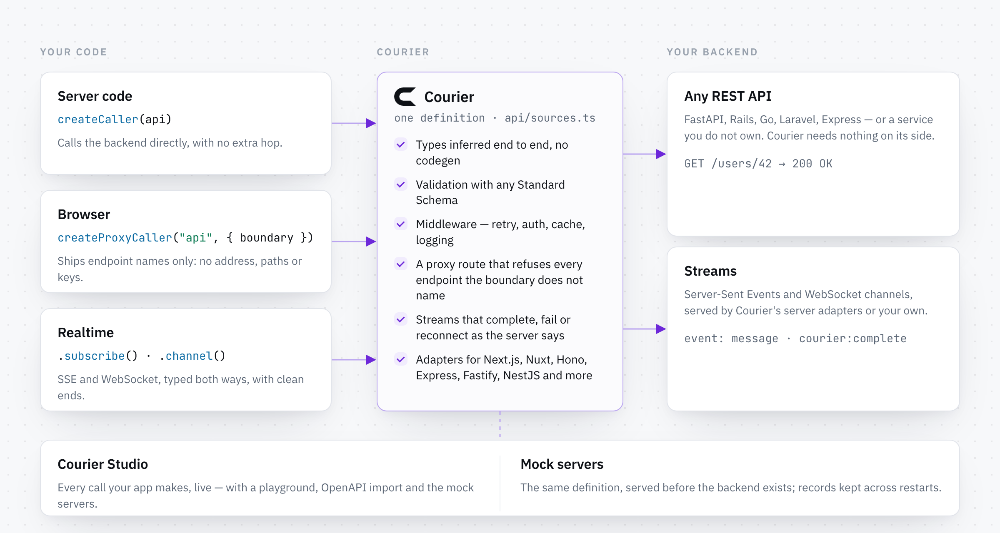

<div align="center">
  <br />
  <picture>
    <source media="(prefers-color-scheme: dark)" srcset="../../docs/public/logos/courier-mark-light.svg" />
    <source media="(prefers-color-scheme: light)" srcset="../../docs/public/logos/courier-mark-dark.svg" />
    
  </picture>

  <h1>One API, three callers</h1>

  <p><strong>The smallest complete Courier project: a backend, the proxy in front of it, a page's caller and server code.</strong></p>

  <p>
    <a href="#run-it"><strong>Run it</strong></a>
    &nbsp;·&nbsp;
    <a href="https://courier.noverax.cloud/docs/quick-start">Quick start</a>
    &nbsp;·&nbsp;
    <a href="../../README.md">Courier</a>
  </p>

  <br />

  <picture>
    <source media="(prefers-color-scheme: dark)" srcset="../../.github/assets/architecture-dark.png" />
    <source media="(prefers-color-scheme: light)" srcset="../../.github/assets/architecture-light.png" />
    
  </picture>
  <br />
</div>

<br />

## What it shows

A REST backend that knows nothing of Courier — it could be FastAPI, Rails or
Go — is defined once in [`src/api.ts`](src/api.ts) and called three ways:

- **Server code** calls the backend directly ([`src/direct.ts`](src/direct.ts)).
- **A page** calls it through your server ([`src/client.ts`](src/client.ts)). It
  imports the API as a type and the boundary as its only value, so the
  backend's address and paths never ship with the page.
- **Your server** runs Courier's proxy ([`src/server.ts`](src/server.ts)) and
  answers only the endpoints the boundary in
  [`src/boundary.ts`](src/boundary.ts) names.

The API also has a `live` group: `live.ticks` streams the backend's own
server-sent events, a tick a second, and `live.chat` is a chat your server
keeps itself, since the backend has no sockets. A page reaches both through
the proxy, as it reaches the rest.

## Run it

From the repository root:

```bash
npm ci
npm run build
npm run demo --workspace examples/basic
```

The demo starts the backend on port 4401 and the proxy on port 3001, makes
each call, reads three ticks, says hello in the chat, prints what came back,
and stops both.

## Run the pieces yourself

```bash
npm run studio --workspace examples/basic     # Courier Studio, on :6280
npm run upstream --workspace examples/basic   # the backend, on :4401
npm run server --workspace examples/basic     # the proxy, on :3001
```

The server connects to Studio through `attachRuntime()` in
[`src/dev.ts`](src/dev.ts): Studio's Timeline shows each request the proxy
serves, and its Playground sends the `users` endpoints, subscribes to
`live.ticks` and joins `live.chat`, through the proxy or directly. In
production the same proxy runs from [`courier.config.ts`](courier.config.ts)
with `npx @noverax/courier-server`.

<br />

<div align="center">
  <sub>Part of <a href="https://github.com/NoveraX/courier">Courier</a> · built by <a href="https://github.com/NoveraX">NoveraX</a></sub>
</div>
